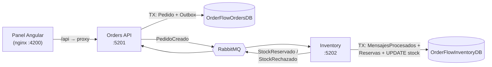

# OrderFlow

Panel de operaciones para registrar pedidos y seguir su estado. Cada pedido nace en **Pending**; el servicio de inventario intenta reservar el stock y el pedido pasa a **Confirmed** (había stock) o **Rejected** (no había), todo de forma asíncrona por RabbitMQ.

| Pieza | Tecnología |
|---|---|
| Orders API e Inventory | .NET 9, Web API con Swagger, capas DTO / Datos / Negocios / API, ADO.NET |
| Mensajería | RabbitMQ + MassTransit 8 |
| Base de datos | SQL Server 2022 (una base por servicio) |
| Panel web | Angular 21 (NgModules) + Bootstrap, servido por nginx |
| Tests | xUnit + Moq + Testcontainers |

---

## 1. Inicio rápido

Requisitos: **Docker Desktop**. Para los tests, además, el **SDK de .NET 9**.

```bash
docker compose up --build
```

La primera vez tarda unos minutos (descarga de imágenes y compilación). Cuando `orderflow-frontend` aparece como iniciado, todo está listo:

| Qué | Dónde | Credenciales (solo desarrollo) |
|---|---|---|
| **Panel de pedidos** | http://localhost:4200 | — |
| Swagger de Orders API | http://localhost:5201/swagger | — |
| Swagger de Inventory | http://localhost:5202/swagger | — |
| Panel de RabbitMQ | http://localhost:15673 | `orderflow` / `OrderFlow_Rabbit_2026!` |
| SQL Server | `localhost,14333` | `sa` / `OrderFlow_Sa_2026!` |

`docker compose up` levanta **todo**: SQL Server, un contenedor `db-init` que crea las bases y carga el stock inicial, RabbitMQ, las dos APIs y el panel. No hay pasos manuales. Las contraseñas son valores por defecto de desarrollo definidos en `docker-compose.yml`; se pueden cambiar con un archivo `.env` (ver `.env.example`).

> Los puertos publicados (14333, 5673, 15673) no son los estándar a propósito, para no chocar con un SQL Server o RabbitMQ que ya esté instalado en el equipo.

**Tests** (con Docker encendido, porque uno de ellos levanta un SQL Server desechable):

```bash
dotnet test OrderFlow.sln
```

**Apagar y borrar los datos:** `docker compose down -v`.

---

## 2. Cómo verificar los criterios de aceptación

Stock inicial (semilla): `ABC-01` = 100, `ABC-02` = 50, `ABC-03` = 5, `ABC-04` = 0.

| Criterio | Cómo comprobarlo |
|---|---|
| Pedido válido pasa de Pending a Confirmed | En el panel, **Nuevo pedido** → `ABC-01` × 2. La lista lo muestra en *Pendiente* y en 1–3 s pasa a *Confirmado* (la fila se resalta y aparece un aviso). |
| Pedido sin stock pasa a Rejected | `ABC-04` × 1 (stock 0) o `ABC-03` × 6 (stock 5). Pasa a *Rechazado* y muestra el motivo: *"Stock insuficiente: se pidieron 6 y hay 5 disponibles."* |
| Datos inválidos muestran un error claro en pantalla | Enviar el formulario vacío, con nombre de solo espacios o cantidad 150. El error aparece debajo de cada campo. El backend valida lo mismo y devuelve `400` con el error por campo (probar en Swagger con `{"clienteNombre":"","sku":"XYZ","cantidad":0}`). |
| El mismo `OrderCreated` procesado dos veces descuenta una sola vez | Ver abajo. |
| Tests con un solo comando | `dotnet test OrderFlow.sln` |

### Demostrar la idempotencia

**Opción A, reenviar eventos reales desde el Outbox.** El Outbox de Orders guarda cada `PedidoCreado` con su `EventoId`. Si se marcan como no publicados, el publicador los vuelve a enviar **con el mismo EventoId**, que es exactamente lo que pasa cuando RabbitMQ reentrega un mensaje:

```bash
# 1. Ver el stock actual
curl http://localhost:5202/stock

# 2. Reenviar TODOS los PedidoCreado ya procesados
docker exec orderflow-sqlserver /opt/mssql-tools18/bin/sqlcmd -S localhost -U sa -P 'OrderFlow_Sa_2026!' -C -I -d OrderFlowOrdersDB -Q "UPDATE ped.Outbox SET PublicadoEn = NULL"

# 3. Unos segundos después: el stock no cambió
curl http://localhost:5202/stock
docker logs orderflow-inventory-api | grep "ya procesado"
```

Los logs de Inventory muestran *"Pedido … ya procesado (Reservado); stock sin cambios, se republica el resultado."* y los de Orders, *"StockReservado … ya fue procesado; se ignora."*.

**Opción B, publicar a mano desde el panel de RabbitMQ.** En *Exchanges → `OrderFlow.Contratos.Pedidos:PedidoCreado` → Publish message*, con la propiedad `content_type = application/vnd.masstransit+json` y este payload. Si se publica **dos veces**, `ABC-01` baja 2 unidades, no 4:

```json
{
  "messageId": "11111111-1111-1111-1111-111111111111",
  "messageType": ["urn:message:OrderFlow.Contratos.Pedidos:PedidoCreado"],
  "message": {
    "eventoId": "11111111-1111-1111-1111-111111111111",
    "pedidoId": "22222222-2222-2222-2222-222222222222",
    "sku": "ABC-01",
    "cantidad": 2,
    "ocurridoEn": "2026-11-13T10:00:00Z"
  }
}
```

Con `"cantidad": -5` el evento se rechaza sin tocar el stock y va directo a la cola `inventory-pedido-creado_error`.

La misma garantía está cubierta por un test de integración contra SQL Server real (ver [Tests](#7-tests)).

---

## 3. Arquitectura



1. `POST /orders` valida, guarda el pedido en **Pending** y, **en la misma transacción**, el evento `PedidoCreado` en la tabla Outbox. Responde `201`.
2. `PublicadorOutboxService` (tarea de fondo de Orders) publica los eventos pendientes cada segundo.
3. Inventory consume `PedidoCreado`, descuenta el stock si alcanza y publica `StockReservado` o `StockRechazado`.
4. Orders consume la respuesta y cambia el pedido a **Confirmed** o **Rejected** (solo si sigue en Pending).
5. El panel consulta `GET /orders` cada 3 s y refleja el cambio.

### Estructura del repositorio

```
OrderFlow.sln                  # todos los proyectos (dotnet test OrderFlow.sln)
docker-compose.yml
BaseDatos/inicializar.sh       # lo ejecuta el contenedor db-init
Orders_BACK/
├── BaseDatos/                 # 00 base y login · 01 esquema · 02 permisos · 03 semillas
├── CapaDTO/                   # contratos de eventos, peticiones, respuestas, modelos
├── CapaDatos/                 # ADO.NET: Interfaz/ + Implementacion/ (cls*CapaDatos)
├── CapaNegocios/              # reglas: validación, máquina de estados, orquestación
├── Orders_Api/                # controllers, consumidores, publicador del Outbox, Program.cs
├── Orders_Tests/
└── Dockerfile
Inventory_BACK/                # misma estructura de capas
OrderFlow_FRONT/               # Angular: core/ · shared/ · features/pedidos/
k8s/                           # manifiestos de Kubernetes (bonus)
docs/DEPURACION_LOCAL.md       # depurar desde Visual Studio sin tocar Docker
```

Cada servicio sigue la misma separación por capas. La API solo traduce HTTP o mensajes a llamadas de negocio; **Negocios** decide (validación, transiciones, qué responder); **Datos** solo habla con SQL Server. Los consumidores de RabbitMQ son tan delgados como los controllers.

### Contratos

| Evento | Publica | Consume | Campos |
|---|---|---|---|
| `PedidoCreado` | Orders | Inventory | `eventoId, pedidoId, sku, cantidad, ocurridoEn` |
| `StockReservado` | Inventory | Orders | `eventoId, pedidoId, sku, cantidad, ocurridoEn` |
| `StockRechazado` | Inventory | Orders | `… , motivo` |

Las clases de contratos están **duplicadas** en el `CapaDTO/Contratos` de cada servicio con el mismo namespace (MassTransit enruta por nombre completo de tipo). Así ningún servicio depende de un proyecto del otro.

---

## 4. Decisiones de arquitectura

| Decisión | Por qué |
|---|---|
| **.NET con capas DTO / Datos / Negocios / API** | Es la estructura con la que trabajo en otros proyectos de microservicios. Separa responsabilidades sin agregar frameworks (sin MediatR ni CQRS), proporcional al problema. |
| **SQL Server, una base por servicio** | Cada servicio es dueño de sus datos; Orders nunca lee el stock y Inventory nunca lee pedidos. Comparten la instancia solo por simplicidad local. |
| **ADO.NET en vez de Entity Framework** | Las operaciones críticas son SQL concreto que hay que controlar: `UPDATE … WHERE Disponible >= @Cantidad`, `UPDLOCK, READPAST` en el Outbox, PK como guardia de idempotencia. Con SQL explícito se ve y se defiende exactamente qué hace la base. |
| **Scripts SQL re-ejecutables + contenedor `db-init`** | `docker compose up` crea bases, logins con mínimo privilegio (`GRANT` solo de lo necesario) y semillas. Los scripts usan `IF OBJECT_ID … IS NULL` y `MERGE`: un segundo `up` no falla ni duplica datos, y **no resetea el stock** ya descontado. |
| **RabbitMQ + MassTransit** | MassTransit resuelve el transporte (exchanges, colas, serialización, reintentos, cola `_error`). La **idempotencia y el Outbox los implementé yo**, no con las funciones de MassTransit, para que la lógica sea visible y explicable. |
| **Transactional Outbox en Orders** | El pedido y su evento se guardan en la misma transacción. Si RabbitMQ está caído, el pedido igual se crea y el evento se publica cuando vuelva. Nunca queda un pedido sin evento ni un evento sin pedido. |
| **Idempotencia en la base de datos** | Ver la sección siguiente. Es la única forma de garantizarla con varias réplicas y reentregas. |
| **Copia del catálogo en Orders** (`ped.Productos`) | Para validar que el SKU existe sin una llamada síncrona a Inventory, que acoplaría la disponibilidad de ambos. Trade-off: hay que mantener los dos catálogos alineados (ver *Qué haría distinto*). |
| **Inventory como Web API con consumidor** | Su trabajo principal es el consumidor, pero exponer Swagger, `GET /stock` y health checks facilita operarlo, demostrar la idempotencia y configurar probes en Kubernetes. |
| **Errores como ProblemDetails** | Los `400` traen el error por campo (`errors.clienteNombre`, `errors.cantidad`…), el mismo formato que usa ASP.NET para JSON mal formado. El front maneja un solo formato. |
| **Polling cada 3 s en vez de SignalR** | El PDF lo acepta. Con `exhaustMap` no se acumulan peticiones si el backend va lento, y un fallo no detiene el refresco. SignalR queda en *Qué haría distinto*. |
| **nginx como proxy de `/api`** | El navegador habla solo con el origen del panel: no hace falta CORS en Docker y no hay URLs del backend compiladas en el bundle. |
| **Configuración por variables de entorno** | Ninguna cadena de conexión ni contraseña está en el código ni en `appsettings.json`. Si falta una variable, el servicio no arranca y dice cuál falta. |

### Idempotencia en detalle

**Inventory** (`clsReservasCapaDatos.Procesar`), todo en **una transacción**:

1. `INSERT` del `EventoId` en `inv.MensajesProcesados`. Si la PK falla, el evento ya se procesó: no se toca el stock y se devuelve el resultado guardado.
2. Si el pedido ya tiene fila en `inv.Reservas` (aunque llegue con otro EventoId), tampoco se descuenta.
3. `UPDATE inv.Stock SET Disponible -= @Cantidad WHERE Sku = @Sku AND @Cantidad > 0 AND Disponible >= @Cantidad`. La condición y el descuento son una sola sentencia atómica: dos pedidos concurrentes no pueden dejar el stock en negativo, y además hay un `CHECK (Disponible >= 0)`.
4. Se guarda el resultado y el `EventoRespuestaId` en `inv.Reservas`, y se hace commit.

Si la publicación de la respuesta falla después del commit, MassTransit reintenta, el paso 1 detecta el duplicado y se **republica la misma respuesta con el mismo EventoId**. Así Orders también la reconoce como duplicada.

**Orders**: el consumidor registra el `EventoId` en `ped.MensajesProcesados` y cambia el estado con `UPDATE … WHERE Estado IN ('Pending')`, en la misma transacción. Un evento repetido o tardío (por ejemplo, un `StockRechazado` después de un `StockReservado`) no cambia nada. La máquina de estados vive en `clsTransicionesPedido`: solo se sale de Pending; Confirmed y Rejected son finales.

---

## 5. Manejo de fallos

Los escenarios marcados con ✔ se probaron con el sistema corriendo en Docker (deteniendo contenedores o publicando mensajes a mano).

| Escenario | Qué pasa |
|---|---|
| ✔ **RabbitMQ caído cuando Orders crea un pedido** | La API responde `201` igual. El evento queda en `ped.Outbox` y el publicador reintenta cada segundo (anota `Intentos` y `UltimoError`). Al volver RabbitMQ, se publica solo y el pedido termina confirmado. |
| ✔ **Inventory caído** | `PedidoCreado` espera en la cola durable `inventory-pedido-creado` y el pedido sigue en **Pending** (el panel lo muestra así). Al volver Inventory, lo procesa y el pedido pasa a Confirmed. No se pierde nada. |
| **Error transitorio al procesar** (p. ej. SQL Server caído) | MassTransit reintenta a los 1, 5, 15 y 30 s. Si se agotan, el mensaje va a la cola `*_error` para revisión manual. |
| ✔ **Evento duplicado** | No descuenta stock; republica el resultado original (ver *Idempotencia*). |
| ✔ **Evento inválido** (cantidad ≤ 0, SKU vacío) | `EventoInvalidoException`: se excluye de los reintentos y va directo a `inventory-pedido-creado_error`. Una cantidad negativa nunca llega al `UPDATE` (sumaría stock). |
| ✔ **Health checks con RabbitMQ caído** | `/health/ready` responde `Degraded` (HTTP 200) y `/health`, `Healthy`. Es intencional: gracias al Outbox, Orders **puede seguir aceptando pedidos** sin broker, así que no debe salir del balanceador. |
| **Health checks con SQL Server caído** | El check de SQL Server queda `Unhealthy` y `/health/ready` responde `503`: la réplica deja de recibir tráfico (sin base no puede atender), mientras `/health` sigue en `200` para que Kubernetes no la reinicie en bucle por una dependencia caída. |
| **Orders API caída con el panel abierto** | El panel muestra un aviso, conserva los últimos datos y el indicador se pone en rojo; el polling sigue y se recupera solo cuando la API vuelve. |

**Caso encontrado durante las pruebas:** si Orders publica antes de que Inventory haya creado su cola, RabbitMQ descarta el mensaje (no hay cola enlazada al exchange) y el pedido queda en Pending para siempre. En Docker se evita con `depends_on: inventory-api: service_healthy` (la cola existe antes del primer pedido). Para recuperar esos pedidos basta reenviar sus eventos del Outbox (`UPDATE ped.Outbox SET PublicadoEn = NULL WHERE …`). En Kubernetes no hay `depends_on`; la solución de fondo está en *Qué haría distinto*.

---

## 6. Trade-offs asumidos

- **Pedidos en Pending sin límite de tiempo.** Si Inventory no vuelve nunca, el pedido no se rechaza solo. Preferí no perder pedidos a rechazarlos por timeout (rechazar exige compensar el stock si Inventory responde tarde).
- **Catálogo duplicado** en Orders e Inventory, a cambio de no tener llamadas síncronas entre servicios.
- **Sin paginación** en `GET /orders`: devuelve los 200 más recientes. Suficiente para un panel de operaciones de prueba.
- **Contraseñas de desarrollo con valores por defecto en `docker-compose.yml`**, para que `docker compose up` funcione sin pasos manuales. En otros entornos se sobreescriben con variables de entorno o secretos (ver Kubernetes).
- **Una sola instancia de SQL Server** para las dos bases (separadas lógicamente).
- **Sin autenticación**, fuera del alcance pedido.

---

## 7. Tests

```bash
dotnet test OrderFlow.sln      # requiere Docker en ejecución
```

| # | Proyecto | Test | Qué protege |
|---|---|---|---|
| 1 | Orders_Tests | `Crear_ConDatosInvalidos_DevuelveErrorEnElCampoYNoGuarda` (5 casos) | Nombre vacío o con solo espacios, SKU inexistente, cantidad 0 o 101: error en el campo correcto y no se guarda nada. |
| 2 | Orders_Tests | `Crear_ConDatosValidos_GuardaEnPendingConSuEventoPedidoCreadoEnElOutbox` | El pedido nace en Pending y su evento va al Outbox describiendo el mismo pedido. |
| 3 | Orders_Tests | `EsValida_SoloPermiteSalirDePending` (6 casos) | Máquina de estados: Confirmed y Rejected son finales. |
| 4 | Inventory_Tests | `ProcesarPedidoCreado_ConDatosInvalidos_NoTocaElStock` (3 casos) | Cantidad ≤ 0 o SKU vacío nunca llegan a la base de datos. |
| 5 | Inventory_Tests | `ElMismoPedidoCreadoProcesadoDosVeces_DescuentaElStockUnaSolaVez` | **Integración con SQL Server real** (Testcontainers) usando el mismo `01_esquema.sql` de `db-init`: el stock baja una vez, hay una sola reserva y la segunda respuesta tiene el mismo EventoId. |

El test 5 usa una base real a propósito: la idempotencia vive en SQL (PK y `UPDATE` condicional) y un mock no la demostraría. Para comprobar que el test sirve, quité temporalmente las protecciones del código y falló (`Expected: 98, Actual: 96`).

---

## 8. Despliegue (bonus Kubernetes)

Los manifiestos están en [`k8s/`](k8s): Namespace, y para **cada API** un Deployment, un Service, un ConfigMap y una plantilla de Secret. Validados contra el esquema oficial con `kubeconform -strict` (9 recursos válidos). No requieren un clúster para revisarse.

| Elemento | Configuración |
|---|---|
| Réplicas | 2 por servicio, `RollingUpdate` con `maxUnavailable: 0` (sin cortes al actualizar) |
| livenessProbe | `/health`: solo el proceso; no reinicia la API si cae una dependencia |
| readinessProbe | `/health/ready`: si SQL Server no responde, el Service deja de enviarle tráfico. RabbitMQ caído solo la marca *Degraded* (sigue recibiendo tráfico: el Outbox permite seguir creando pedidos) |
| Recursos | requests `100m` / `128Mi`, limits `500m` / `256Mi` |
| Seguridad | usuario no root (UID 1654 de la imagen), sin escalamiento de privilegios |
| Configuración | ConfigMap (no secreta) + Secret (cadenas de conexión, credenciales) vía `envFrom`: las mismas variables que en Docker |

**Por qué el diseño soporta varias réplicas:** el Outbox se lee con `UPDLOCK, READPAST` (cada réplica de Orders publica eventos distintos) y los consumidores son idempotentes (varias réplicas de Inventory compiten por la misma cola; una reentrega nunca descuenta dos veces).

### Cómo desplegaría el sistema completo

```
Navegador ──► Azure Static Web Apps (panel Angular)
                   │  apiUrl de /assets/config.json
                   ▼
              Ingress (HTTPS) ──► orders-api ×2 ──► Azure SQL · OrderFlowOrdersDB
                                     │
                                  RabbitMQ (gestionado, o StatefulSet con volumen)
                                     │
                                inventory-api ×2 ──► Azure SQL · OrderFlowInventoryDB
```

1. **Panel en Azure Static Web Apps.** El front ya está preparado: `public/staticwebapp.config.json` (fallback de rutas de Angular) y la URL de la API se lee en tiempo de ejecución de `/assets/config.json` (`ConfigService` + `provideAppInitializer`). En Docker vale `/api`; al publicar en SWA se reemplaza por la URL pública de Orders API. El mismo build sirve para cualquier entorno.
2. **Orders API expuesta con un Ingress** (HTTPS) para que el panel la llame. Como queda en otro dominio, se activa CORS solo para el dominio de SWA con `Cors__OrigenesPermitidos` (ya está en el ConfigMap; sin esa variable, CORS no se habilita).
3. **Inventory sin exposición pública:** solo habla por RabbitMQ.
4. **SQL Server** como Azure SQL Database (dos bases). **RabbitMQ** como servicio gestionado o StatefulSet con volumen persistente.
5. **`db-init` se convierte en un Job** de Kubernetes que ejecuta los scripts de `BaseDatos/` antes de desplegar las APIs (los scripts ya son re-ejecutables).
6. **Secretos** desde Azure Key Vault (Secrets Store CSI Driver) en lugar de crear el Secret a mano.
7. **Imágenes** en Azure Container Registry: las mismas que construyen los Dockerfiles multi-stage (APIs sobre `aspnet:9.0-alpine`, unos 212 MB; panel sobre `nginx:alpine`, unos 77 MB).

---

## 9. Qué haría distinto con más tiempo

- **No depender del orden de arranque para no perder eventos.** Publicar con *publisher confirms* y `mandatory`, o que Orders declare la cola de Inventory al iniciar, para que un `PedidoCreado` nunca se descarte por falta de cola (en Kubernetes no hay `depends_on`).
- **Timeout de pedidos en Pending con compensación.** Rechazar los que superen N minutos y, si luego llega un `StockReservado` tardío, publicar una liberación de stock.
- **Actualización en tiempo real con SignalR**, manteniendo el polling como respaldo.
- **Catálogo sincronizado por eventos** (`ProductoCreado`/`ProductoActualizado`) en vez de semillas duplicadas.
- **Migraciones versionadas** (por ejemplo DbUp) en lugar de scripts idempotentes `IF NOT EXISTS`, para soportar cambios de esquema en bases con datos.
- **Observabilidad:** OpenTelemetry (trazas que sigan un pedido de Orders a Inventory y de vuelta), métricas de antigüedad del Outbox y alertas sobre las colas `_error`.
- **Paginación y filtros en el servidor** para `GET /orders`.
- **Tests del frontend** (formulario y mapeo de errores del servidor) y un test de integración de punta a punta con RabbitMQ en Testcontainers.
- **Concurrencia:** un test que procese el mismo pedido en paralelo desde dos consumidores.

---

## 10. Depuración local

Para depurar Orders e Inventory desde Visual Studio **sin afectar** lo que corre en Docker (bases `_Local`, vhost propio de RabbitMQ y otros puertos), ver [docs/DEPURACION_LOCAL.md](docs/DEPURACION_LOCAL.md).

---

## 11. Uso de asistentes de IA

Usé Claude (Anthropic) como asistente de desarrollo. La arquitectura y las convenciones son las mismas que aplico en mis proyectos de microservicios: capas DTO / Datos / Negocios / API, ADO.NET sobre SQL Server, MassTransit con RabbitMQ, Outbox y tabla de mensajes procesados, y Angular con `core/` / `shared/` / `features/`. Yo definí y dirigí cada decisión; el asistente generó código siguiendo esa estructura, y revisé, probé y ajusté todo lo que se entrega.
